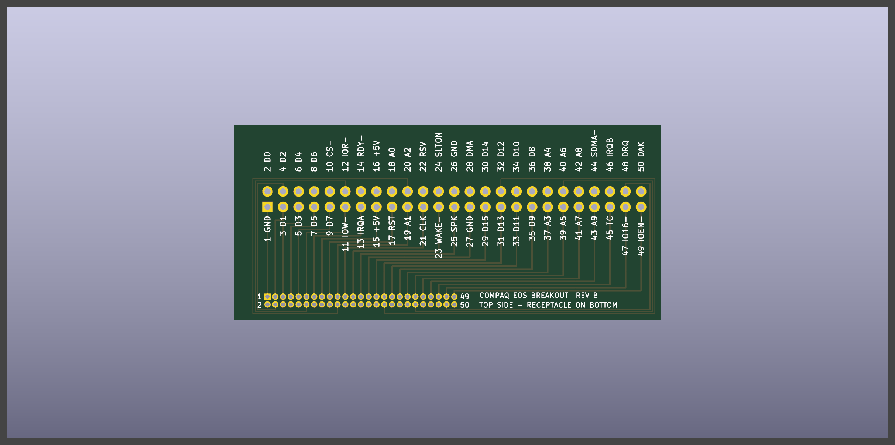
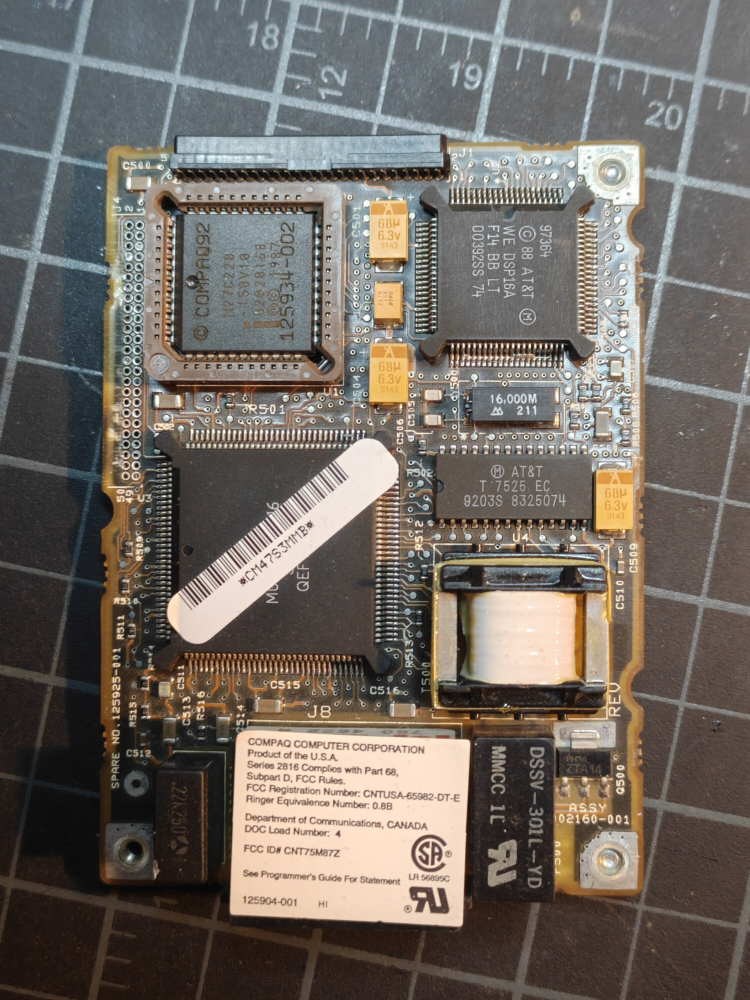

A Hayes-compatible WiFi modem card for the Compaq Portable 486c's 50-pin Enhanced Options Slot. AT commands in, TCP connections out. No PCMCIA slot required, no external serial cable. Just a custom card that slides in from the rear and gives this luggable a modern internal modem over WiFi. Useful for none other than original DOS terminal software dialing into BBSes.

## Status

Still Phase 0, but with a lot more known. The architecture is settled, the slot is documented properly, and the breakout board is on order from OSH Park.

Where things stand:

- Slot pinout cross-checked against a second Compaq document. Every pin now has a direction and a function.
- Architecture settled. A real 16C550 UART goes on the bus. The ESP32 sits behind it on the serial side and never touches the bus.
- Original Compaq modem torn down and photographed. It is built the same way, which is reassuring.
- Mating connector desoldered from that modem. It is keyed, so nothing off the shelf fits the slot.
- Custom breakout board designed around that one connector. Passes design rule check. Paper print checked against the modem's holes and it lines up.
- Breakout board ordered from OSH Park, four layers. Waiting on it.
- No firmware yet. Nothing has driven the bus yet.

Progress in detail:

- **[Options slot reference](/projects/compaq-wifimodem/options-slot/)**: what every signal does, which direction it goes, and where that information came from
- **[Pinout and wiring](/projects/compaq-wifimodem/pinout/)**: all 50 pins and how the 16C550 and ESP32 hook up
- **[Original modem teardown](/projects/compaq-wifimodem/modem-teardown/)**: what Compaq put on their own card and what it says about the slot
- **[Breakout board](/projects/compaq-wifimodem/breakout/)**: getting 50 signals out of a 1.27mm connector without a single via

## Two documents, one slot

The 486c manual has a pin table for the slot and nothing else. Pin numbers and short names. No directions, no polarities, no descriptions.

The Compaq LTE Lite technical guide documents the same 50-pin slot, pin for pin, with a full signal table. Direction, polarity, function, even the configuration registers on the system side. So the pinout here uses the 486c's pin numbers and the LTE Lite guide's descriptions.

The scan of the 486c manual also has mangled names. Q reads as 0, D reads as O. "SLOT-IR08" is really SLOT-IRQB. "XA08" on pin 18 is address bit 0.

One caveat I am carrying forward. All of this assumes the 486c slot and the LTE Lite slot are the same interface. The pin numbers match signal for signal, so I think that is safe. But it is an inference until I confirm it on the actual machine.

## Architecture

A real 16C550 UART on the bus. The ESP32 behind it on the serial side.

```
486c slot (5V, ISA timing) <=> 16C550 UART <=> TTL serial <=> ESP32 <=> WiFi
```

The UART handles bus timing, registers, FIFOs, and interrupts in hardware. That is what it was made for. The ESP32 sits where a modem's data pump would be and just does serial to WiFi. It never touches the bus.

Why this way:

- **No bus timing risk.** An ISA read strobe is around 500ns. The 16C550 was built for that. An ESP32 polling GPIO would be marginal.
- **No level shifters on the bus.** The 16C550 runs at 5V and connects straight to the slot.
- **8 GPIOs on the ESP32.** Serial, flow control, a few modem control lines.
- **Real UART behavior for free.** DLAB, loopback, interrupt priorities, FIFO. All in silicon, all things DOS software pokes at.
- **Existing firmware works.** Flash Zimodem and it is a modem.
- **The first test needs no ESP32 at all.** Just the UART on the bus and `DEBUG`.

One thing needs solving. DOS sets the baud rate inside the UART and the ESP32 can't see that. Fix is the 16550's BAUDOUT pin. It puts out 16 times the baud rate. The ESP32 measures that frequency and sets its own UART to match.

The original Compaq modem is partitioned the same way. Custom ASIC next to the connector doing the bus interface, separate processor behind it doing the modem work. No CPU in the bus path. [More on that in the teardown](/projects/compaq-wifimodem/modem-teardown/).

## The connector



The slot header on the system I/O board is a shrouded 2x25 at 1.27mm pitch. And it is keyed. Generic 1.27mm sockets and those little pitch adapter boards do not fit. I looked.

The original modem has two 50-pin connectors on it. One on a short edge, one along a long edge. The 486c uses the long edge one. The modem stands upright on it with the phone jacks facing the rear. Desoldered that one. It is the only one I have.

Tried hand-wiring it on a 1.27mm proto board first. Fifty wires on 1.0mm pads with a quarter millimeter between them. No. But the proto board did tell me something useful: the connector seats in it, so the pins are on a plain 1.27mm square grid. That plus one measurement off the modem (2.55mm from the board edge to the first row of holes) was enough to draw a footprint.

So there is a custom breakout now. Original connector on the bottom edge, 2x25 0.1" header on top, every pin labeled. [Details here](/projects/compaq-wifimodem/breakout/).

Because there is exactly one connector, the breakout is going to be the permanent carrier. The electronics go on a second board that plugs onto its header. If that board needs a respin, the connector stays put.

## The Plan

### Phase 0a: Look before touching

Nothing drives the bus in this phase.

First the modem, with a multimeter. The connector pads are exposed now and the bus ASIC sits right behind them. Which pads reach the ASIC answers a lot:

- Pin 10 (Select) connected and A3 through A9 not. The system does the address decode and I can lean on it.
- A3 through A9 connected. The card decodes its own address and I need a decoder chip.
- Pin 21 going anywhere. The UART clock is expected on the slot.
- Where pins 49 and 14 go.

Then the machine, with the breakout and a logic analyzer. Configure COM2 in the EISA utility, run `I 2F8`, `I 2F9`, `O 2F8 55` in `DEBUG`, and watch Select, the strobes, A0 through A2, reset, and pin 21.

### Phase 0b: UART on the bus, no ESP32

16C550 on a breadboard, short wires from the breakout. Loop its serial output back to its input.

1. `DEBUG`: `O 2FF 55` then `I 2FF`. Should read back `55`. That is the scratch register.
2. BIOS lists COM2 at POST.
3. Terminal program on COM2 echoes what I type. That exercises interrupts.

No firmware anywhere. If this works the slot is understood.

- Reads `FF`. Check IOEN handling first, then Select and the address wiring.
- Scratch works but no echo. Clock or the interrupt path.
- Hang or POST error. Bus contention.

### Phase 1: ESP32 on the serial side

Pull the loopback, connect the ESP32 through a level shifter. Echo sketch at a fixed baud rate. Then baud tracking off BAUDOUT. Then flash Zimodem for a quick win and to prove the hardware before writing any AT code.

### Phase 2: WiFi bridge

- WiFi credentials set by AT command, stored in flash
- `ATDT<host>:<port>` opens a TCP connection
- Bytes flow both ways, RTS/CTS flow control honored
- `+++` with guard time drops back to command mode

### Phase 3: AT command set

Hayes-compatible for Telix, Procomm, and friends.

- `AT`, `ATZ`, `ATE0/ATE1`, `ATH`, `ATO`, `ATS0=1`
- `ATDThost:port` with `CONNECT`, `NO CARRIER`, `BUSY`
- Carrier detect follows the connection. DTR drop hangs up. Ring indicator pulses on an incoming connection.

### Phase 4: Polish

- Final card in the original modem's form factor, plugged onto the breakout
- Telnet negotiation, a phonebook
- Dial and connect sounds through the system speaker. The slot has a speaker pin. Would be a crime not to.

## Key Risks

1. **The 486c slot might not match the LTE Lite slot.** Every signal direction rests on this. Phase 0a checks it.
2. **IOEN behavior.** I know the card drives it. I don't know exactly when the system expects it.
3. **One connector.** No spares. Every board that carries it has to be right.
4. **Power.** The LTE Lite guide gives the slot 350mA at 5V. ESP32 WiFi transmit bursts go past that. Bulk capacitance and lower TX power.
5. **5V into the ESP32.** Every 16550 output goes through a 3.3V-powered buffer first. No exceptions.
6. **Signal integrity.** Three ground pins and a fine-pitch connector. Keep the bus wiring short.

## Shopping List

- [x] Mating connector (desoldered from the original modem)
- [ ] Multimeter
- [ ] Breakout PCB (ordered from OSH Park, not here yet)
- [ ] Logic analyzer, 8 channels
- [ ] 16C550 in DIP-40, plus a spare
- [ ] 74HCT125 (interrupt gate, IOEN buffer)
- [ ] 74AHC125 at 3.3V (5V to ESP32 level shifting, comes in DIP)
- [ ] ESP32 dev board
- [ ] 1.8432 MHz oscillator, only if pin 21 turns out to have no clock
- [ ] 74HCT688, only if the system does not pre-decode Select

---

## Datasheets

- [Compaq Portable 486c Reference Guide (PDF)](/docs/compaq-wifimodem/Compaq_Portable_486C_Reference_Guide.pdf)
- [Compaq LTE Lite Expansion Options (PDF)](/docs/compaq-wifimodem/Compaq_LTE_Lite_Expansion_Options.pdf)

## References

- [Source Repository](https://github.com/k0bura/compaq-wifimodem): Plan, reference docs, photos, and the breakout board files
- [Compaq Portable 486c Restoration](/projects/compaq-486c-restoration/): The machine this card is being built for
- [Bitsavers Portable 486c photos](https://bitsavers.org/pdf/compaq/Compaq_Portable_486/pictures/): Where I confirmed how the modem sits in the machine
