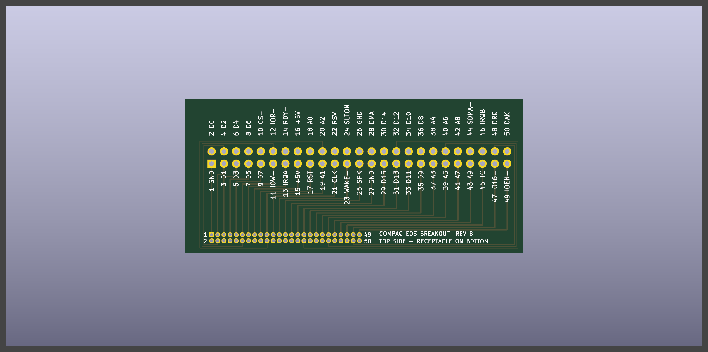
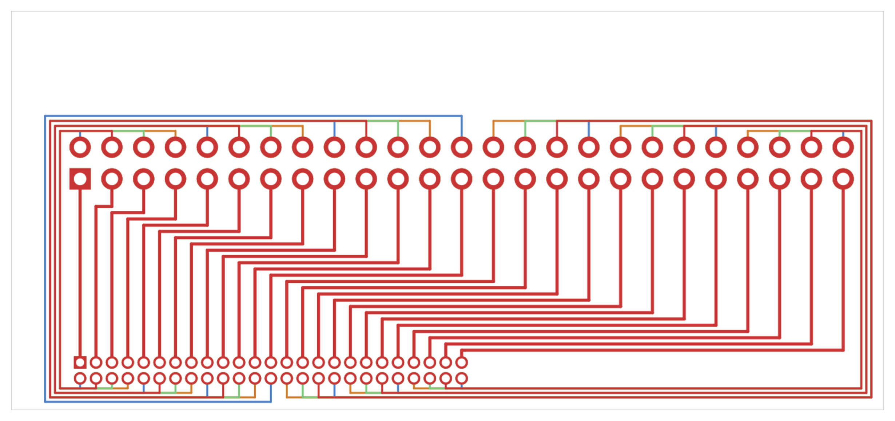

The slot connector is 1.27mm pitch and keyed. I have exactly one mating connector, pulled off an original modem. I can't hand-wire it. I tried.

So it gets its own board. Designed, checked, and on order from OSH Park. Waiting on it.

## What it is

- 69.7 x 31.9mm, four layers, no vias. Three boards on order.
- Original Compaq receptacle on the bottom edge. 2x25 through-hole on a 1.27mm square grid, nearest row 2.55mm from the edge, body on the bottom side. Same as it sat on the modem.
- 2x25 0.1" header along the top. Every pin labeled with its number and signal name. Header pin N is slot pin N.
- Stands upright on the slot header, like the modem did.

## Why off-the-shelf didn't work

There are little fan-out adapters that take a 1.27mm socket to 0.1" pins. Right idea. Two problems. Nobody seems to make a 2x25. And the socket on those is a generic one soldered straddling the board edge. The Compaq header is keyed, so a generic socket doesn't seat. It has to be the original connector, and the original is a right-angle through-hole part.

## The routing problem

This was more interesting than I expected.

Two rows of pads, 1.27mm apart, 1.0mm pads. That leaves 0.27mm between pads. A trace can't legally pass through that. Not at any width a fab will make with a proper annular ring around the hole.

The odd row is fine. It faces the rest of the board, so its traces just leave.

The even row is boxed in. Odd row on one side, board edge 2.55mm away on the other. The only ways out are the two ends of the connector.

So the even pins leave downward, into the 2mm strip between the pads and the board edge. Run sideways along that strip past the end of the connector. Up the side of the board. Over the top of the header. Then drop onto the header pins from above.

Half go left, half go right. Within each group the pin nearest the exit takes the lane nearest the pads, which keeps everything nested and nothing crosses. No vias anywhere. The connector pins themselves tie the layers together.

## Why four layers

The strip is the bottleneck. Twenty-five traces have to squeeze through 2mm of board, and how many fit depends on how fine the fab can etch.

Four layers solves it by brute force. Same strip, four layers of it. At most four traces per layer on each side, so there is room for 0.16mm traces with 0.20mm gaps and more than 15 mil to the board edge. Comfortably inside OSH Park's four-layer rules. Worth it for something that carries the only connector I have.

Some of the even-pin traces are long. Pin 28 goes 103mm to cover about 25mm in a straight line. Fine for ISA-speed signals. Power and ground come off the odd pins (15, 1, 27), which get 0.25mm traces.

## Checks

- KiCad design rule check against OSH Park's four-layer limits: zero violations, zero unconnected nets.
- Read the board file back and confirmed every slot pin shares a net with the same-numbered header pin. 50 separate nets.
- Printed the copper at 1:1 and laid it over the modem's empty connector holes. Every hole lines up, pin 1 on pin 1. That is the check against a mirrored board, which is the one mistake that would be fatal with a single connector.

## Things I am watching

- **Inner layers.** Twelve of the even-pin traces run on the two inner layers, where I can't see them. Every board gets a continuity check from each header pin to its slot pad before the connector goes on.
- **No mounting hole.** The connector is the only thing holding the board. Support it when pushing jumper wires on.
- **Signal names on the silkscreen are not verified yet.** They come from the LTE Lite guide. The back of the board says to check ground and +5V before trusting them.
- **Outline.** It is meant to stay inside the space the modem occupied. I estimated the modem's extents from photos. Need to hold the board against the real thing.

## Why it stays a plain breakout

Thought about putting the 16550 and everything else on this board. Decided not to.

There is one connector. Whatever board it gets soldered to is the board I am stuck with. The circuit still has open questions: whether I need an address decoder, how IOEN has to be driven, whether the clock is on pin 21. Answering those needs this breakout first. If I guess, and guess wrong, I am desoldering 50 fine-pitch pins again.

So this is the permanent connector carrier. The electronics go on a second board that plugs onto the header. If that one needs a respin, the connector never moves.

## Files

Everything is in the [source repository](https://github.com/k0bura/compaq-wifimodem) under `hardware/eos-breakout/`.

- `gen_breakout.py`. The board is generated by a script through KiCad's Python API, not drawn by hand. Change a number, rerun, get a new board.
- `eos-breakout-oshpark.kicad_pcb`. The board, as ordered. KiCad 10.
- `eos-breakout-oshpark-gerbers.zip`. Gerbers for it, named the way OSH Park expects.
- `eos-breakout-1to1.pdf`. The paper test. Print at 100%.
