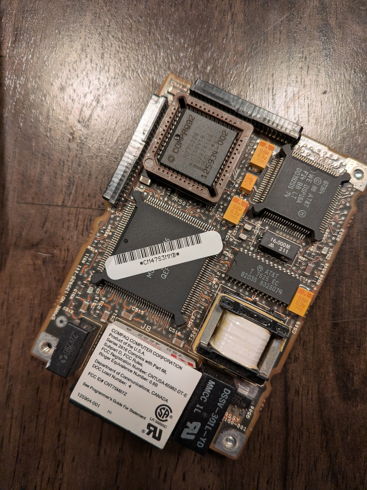
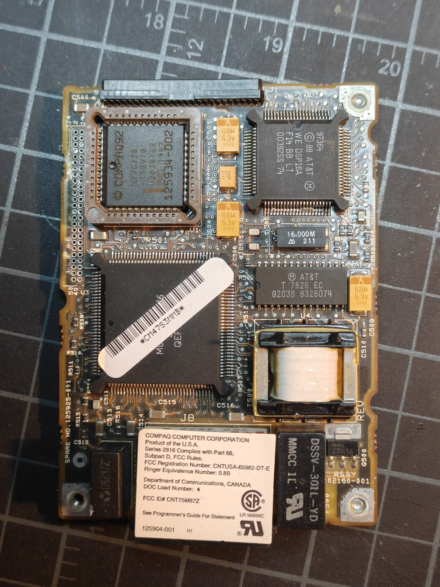
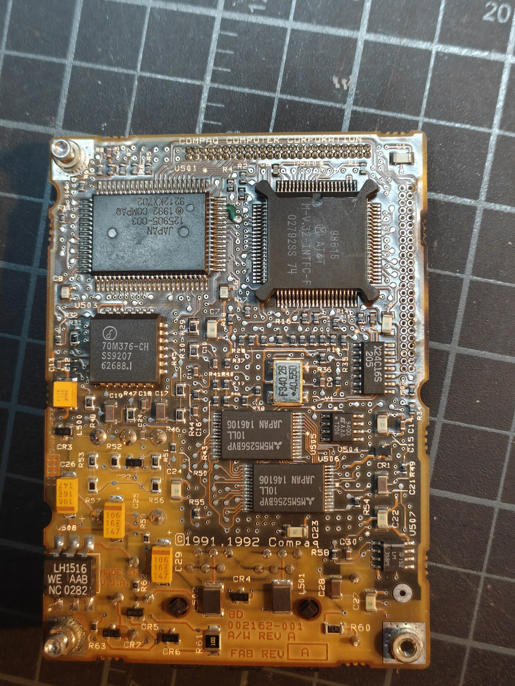
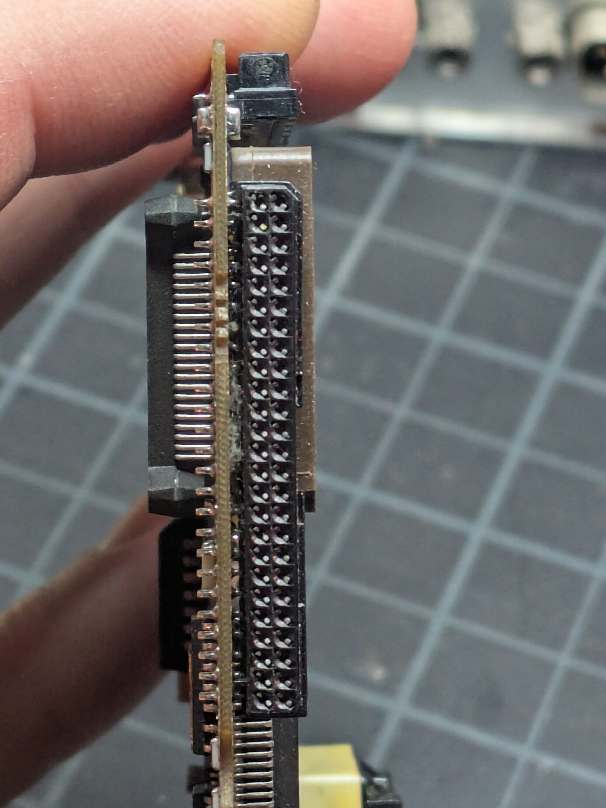

Got hold of an original Compaq modem for the options slot. Mostly wanted it for the connector. But the board itself is the best documentation of the slot I am going to get, so here is everything on it.

## What it is

Spare number 125925-001. Assembly 002160-001, bare board 002162-001. Copyright 1991, 1992. FCC ID CNT75M87Z.

Probably the "Enhanced 9600-bps Data+Fax Modem", option part 125901-002 in the LTE Lite guide's options list. The board's own numbers are all in the same 1259xx range. That match is by number range only. I have not found a document that says so outright.

Went looking for a datasheet, schematic, or technical reference. Searched the spare number, the label number, the chip numbers, the FCC ID. Nothing. The label says "See Programmer's Guide For Statement", so a Compaq programmer's guide exists somewhere. If you have one, I would love a scan.

## What is on it

| Ref | Marking | What it is |
|-----|---------|------------|
| U501 | Compaq 125905-003, 1992, QFP | Custom ASIC right behind the 50-pin connector. Has to be the bus interface. |
| U3 | Large QFP, marking hidden under a barcode sticker in my photos | Presumably the controller CPU |
| U1 | Intel N27C220-150V10, Compaq 125934-002, socketed | 2 Mbit EPROM, 16 bits wide. Firmware. |
| U505, U506 | M5M5256BVP-10LL, two of them | 32K static RAM each |
| | X24C16S | 16 Kbit serial EEPROM. Stored settings. |
| U2 | AT&T WE DSP16A | DSP. The data pump. |
| U500 | AT&T M-V.32-INTFC-F | V.32 interface chip |
| U4 | AT&T T7525 | Codec |
| U503 | 70M376-CH | Analog line interface of some kind. Not positively identified. |
| | 16.000 MHz and 40.550 MHz oscillators | |
| | Transformer, relay, LH1516, LM358 | Phone line side |

## What it tells me about the slot

**There is no 16550 on it.** No discrete UART anywhere. The Compaq ASIC presents the UART registers to the bus itself and hands bytes to the controller internally. The host still sees a normal COM port. The LTE Lite diagnostics test this modem for the DLAB bit, THRE, Data Ready, and interrupts on COM1 or COM2, exactly like any serial card.

**The bus interface is dedicated hardware.** ASIC next to the connector, processor behind it. No CPU answering bus cycles in firmware. Which is the same split I landed on: a 16C550 on the bus, an ESP32 behind it.

| Compaq's modem | Mine |
|---|---|
| Custom host-interface ASIC next to the connector | 16C550 |
| Controller CPU, firmware EPROM, two SRAMs, EEPROM | ESP32 |
| DSP data pump, V.32 chip, codec, phone line parts | ESP32 WiFi |

**Nothing between the connector and the ASIC.** No buffers, no transceivers. So wiring a 16550 straight to the slot is no worse than what Compaq did.

**No jumpers. No DIP switches.** The card cannot be picking its own COM port by hand. Either the system decodes the address and hands the card a chip select, or the ASIC gets configured in software. I am hoping for the first. It would mean I need no address decoder at all.

**No 1.8432 MHz crystal.** Just 16 and 40.55. That fits either story: the ASIC takes the UART clock from slot pin 21, or it does not need one because it is not a real UART. Doesn't settle anything. But the 486c's system I/O board does have a 1.8432 MHz oscillator on it, so the clock is probably on the slot.

**Three 68uF tantalums on the 5V rail.** A whole controller CPU plus a DSP ran off the slot's 5V. Good sign for an ESP32, with enough bulk capacitance.

## Two connectors

The modem has two 50-pin positions carrying the slot signals.

- **J1** on the short edge opposite the phone jacks.
- **J4** along a long edge. Two rows of 25 through-holes, right-angle receptacle, body on the bottom side of the board.

The Portable 486c uses J4. The modem stands upright on its long edge, perpendicular to the system I/O board, phone jacks facing the rear of the machine. The manual says "with the connector on the bottom, slide the modem in from the back", and [this bitsavers photo](https://bitsavers.org/pdf/compaq/Compaq_Portable_486/pictures/486c_PCBs_1.JPG) shows one installed, far left behind the fan. J1 points into the machine and plugs into nothing. Presumably it is there for a different machine, like the LTE Lite.

J4 is the one I desoldered.

## Pin numbering, from the silkscreen

The silkscreen next to the empty J4 holes has "1" and "2" side by side at one end and "49" and "50" at the other. J1 has "2" at one end and "50" at the other. So numbering is odd and even across the rows.

Seen from the top side, the odd pins are the row farther from the board edge.

## Measurements

- Pin grid: 1.27mm by 1.27mm, no stagger. Confirmed because the bare connector seats in a 1.27mm proto board.
- Board edge to the center of the nearest hole row: 2.55mm. Measured on the modem.

Those two numbers are the whole footprint. See the [breakout board](/projects/compaq-wifimodem/breakout/).

## Still to do on this board

The connector pads are exposed now. A multimeter between those pads and the ASIC pins should tell me:

- Pads 1, 26, 27 are ground and 15, 16 are joined. Confirms the numbering matches the manual.
- Whether pad 10 (Select) reaches the ASIC, and whether A3 through A9 (pads 37 to 43) do. That decides if I need a decoder chip.
- Where pads 21, 49, and 14 go.
- Whether J1 and J4 are wired pin for pin. If so, J1 is a free set of test points.

Not done yet.
