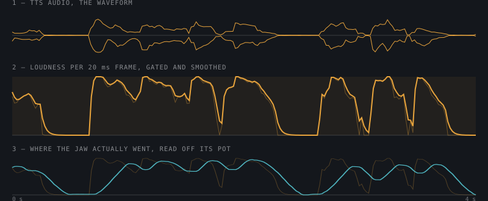

Teddy Ruxpin. 1985, Worlds of Wonder. Cassette in the back, mouth and eyes driven by a control track on the tape's right channel. Mine has been silent for decades. Plan is to make him talk again, but this time answer questions. Ask him something, he searches, answers out loud, mouth and eyes move with the speech. Battery powered, because a bear on a wall wart is not a toy.

The original mechanism is reused as-is. No servos added, no sensors retrofitted, no gears replaced. That constraint turned out to matter less than I thought. More on that below.

## Status

Phase 1 is done. All three servos wired, calibrated, and driven closed-loop from an ESP32. Live speech animates the bear on the bench: Fish Audio streams TTS, a script computes the loudness envelope as chunks arrive, frames go to the board on a 20 ms grid while the audio plays on the desktop. Zero starved, zero underrun, zero dropped frames on the last run.

Song mode works, with the two jaw halves driven from separate signals. Eyes have a gesture table and blink on phrase structure. Control track on the original tapes is decoded at the physical layer, five stories, 200,785 frames. Payload semantics still unknown.

The bear has no audio of its own yet. No mic, no amp, no server. That's phases 2 and 3. And the wake trigger is still an open question, which gates the whole power design.

Progress in detail:

- **[Wiring and power](/projects/superrux/wiring/)**: three supplies, one ground, pot dividers, the pins that bite
- **[How the mouth is driven](/projects/superrux/mouth/)**: loudness alone, no phonemes, and why the mechanism's 2 Hz corner makes that enough
- **[The cassette control track](/projects/superrux/control-track/)**: decoding what the 1985 tapes actually told the motors

## The thing that changed the design

Wrote the whole plan around open-loop control. No position feedback, so home by stalling into the hard stops on every boot, time every move, quantize the jaw to 3 or 4 states because timed moves can't hold a smooth envelope. Lots of compromise baked in.

Then I actually looked at the servo plugs. Five wires, not two.

```
2 x motor  (suppression caps across them)
3 x 5k potentiometer  (in the plastic body behind the gearbox)
```

These are first-generation controllerless servos. Motor and position sensor in the head, amplifier on the main board. It's how the original cassette commanded absolute positions with pulse-position modulation on the right track. The sensors were there the whole time.

| Was going to be | Turned out |
|---|---|
| Stall-home into the stops on every boot | Pot reads position at power-up. Bear never moves on boot. |
| Dead reckoning on travel time, re-home between sentences | Position is read, not inferred. No drift. |
| Jaw quantized to 3 or 4 states | ~2150 usable counts, continuous envelope |
| Minimum duty hand-tuned | Ramp duty until the pot moves. 70, measured automatically. |
| ~80 ms mechanical lag (a guess) | ~75 ms, confirmed from the sweep log |

Measured on the eyes axis first: positioning within ±25 ADC counts, repeatable to 1 or 2 counts on repeat visits. That deleted stall-homing, dead reckoning, boot-time movement, and jaw quantization in one afternoon.

## Architecture

Thin client plus server. The bear is an ESP32 that plays PCM and moves motors. Everything else lives on an always-on box.

```
  BEAR (ESP32-WROOM-32, battery)          SERVER (always-on box)
  ------------------------                ----------------------
  trigger (undecided) -> wake from deep sleep
  I2S mic ---- raw PCM upstream -------->  endpointing (VAD)
                                           -> STT (streaming)
                                           -> Claude (streaming + web search)
                                           -> sentence chunker
                                           -> TTS (streaming)
                                           -> envelope + cue track
  I2S amp <--- frame stream ------------  [seq][jaw][cue][PCM]
  TB6612 x2 <- local gesture table
```

Why split: battery. The ESP32 idles around 10 uA in deep sleep. A Pi Zero 2 W idles at 120 mA. The bear is idle 99.9% of the time, so the Pi was dead on arrival. Also rejected: STM32F103 and STM32F411, no WiFi, no I2S. Both work electrically and the SparkFun TB6612 library compiles on them, but they can't do the job past phase 1.

### Frame protocol

Fixed 20 ms frames, 16 kHz mono s16:

```
[uint16 seq][uint8 jaw_state][uint8 cue_id][320 bytes PCM]
```

Jaw state is a continuous 0 to 255 position. Cue ID indexes the bear's local gesture table. Server sends intent, bear owns the mechanics. Retune gestures by reflashing the bear, never touch the server.

Buffer is ~300 ms, 15 frames. Absorbs network jitter and gives the jaw its lookahead. The motor reads its target a few frames ahead of the playback pointer so the mechanical lag lands the movement on the sound instead of after it.

## Hardware

| Part | Note |
|---|---|
| ESP32-WROOM-32 devkit (Hosyond, CP2102) | In hand. Bare module for the final build. |
| 2x TB6612FNG | Motor drivers, in hand, wired |
| Original Teddy Ruxpin servos | Upper mouth, lower mouth, eyes |
| 3.7 to 4.5 V pack for VM | Motors are 3 V rated. Not the ESP32's 3V3 or VIN. |
| MAX98357A | I2S amp for the original speaker. Phase 3. |
| INMP441 or ICS-43434 | I2S MEMS mic. Phase 2. |
| ~2000 mAh LiPo + charger | Phase 5 |

### Pin map

| Signal | GPIO | | Signal | GPIO |
|---|---|---|---|---|
| AIN1 / AIN2 / PWMA | 32 / 33 / 25 | | upper pot wiper | 34 |
| BIN1 / BIN2 / PWMB | 26 / 27 / 14 | | lower pot wiper | 36 |
| CIN1 / CIN2 / PWMC | 13 / 23 / 22 | | eyes pot wiper | 39 |
| STBY (drivers A/B) | 21 | | I2S out BCLK / LRCLK / DIN | 18 / 5 / 17 |
| STBYC (eyes) | 19 | | I2S mic SCK / WS / SD | 16 / 4 / 15 |

Pot wipers must be on ADC1 (GPIO 32 to 39). ADC2 is dead while WiFi is up. 34, 36, and 39 are input-only, which suits an analog input and costs no output pin. GPIO 12 is unusable; strapping pin, high at boot selects the wrong flash voltage and the board won't start. The WROOM-32 leaves exactly one safe spare output, GPIO 15, so no SD card on the bear. Pre-rendered songs live on the server.

**[Full wiring reference with diagrams →](/projects/superrux/wiring/)**

## Progress Log

### 1. Bench calibration

Firmware in `Calibrate/Calibrate.ino`. Serial console at 115200 with a full command set: read pots, sweep an axis stop to stop logging time and ADC, calibrate endpoints, interactive tune with arrow keys, measure stiction, move to a percent of range, run gestures. All calibration lives in NVS and is retunable over serial without a reflash.

Eyes axis first, 2026-08-24. Closed-loop, ±25 counts, repeatable to 1 or 2. Then upper and lower mouth. Both mouth motors drive as one closed loop on a virtual `jaw` axis that moves them in opposition. Lower jaw homes to the shut stop, not the open one. Got that backwards once.

Stiction is measured, not guessed. Ramp the duty until the pot moves, save it. Came out at 70. Drive at the measured breakaway, not a fixed nominal.

Never command the mechanical limits. There's a margin inset from the stops so a move never stalls.

### 2. Motors couple EMI into the console

First stiction ramp showed framing errors mid-transmission. Motor noise on the UART. Firmware now drops indented input so its own output can never parse as a command, and flushes RX after every move. Physically: keep motor leads away from the USB cable, twist each pair.

Also: use miniterm with RTS and DTR held low, not `arduino-cli monitor`. On this devkit RTS drives EN and DTR drives GPIO 0. A terminal that asserts them on open holds the board in reset or download mode, and you read a stale USB-serial buffer. Fast repeating garbage on an exact 32 byte period. Looks like a firmware fault. Isn't.

### 3. The envelope path

Audio to jaw, end to end, no server or network involved. `tools/envelope.py` takes audio in and emits a jaw envelope: 20 ms frame RMS, gated, low-passed at the measured 2 Hz corner, faster attack than release. The board buffers a whole envelope in RAM, 1500 frames, and plays it on the frame grid. A `--play` flag plays the audio through the desktop at the same time so sync can be judged by eye. The bear has no audio until phase 3 and I wasn't going to wait for that to see whether the mapping looked right.

**[How the mouth is driven →](/projects/superrux/mouth/)**

### 4. Realtime TTS to servos

2026-08-27. `tools/speak.py "Hello Jeff! Do you want to read a story with me today?"` and the bear says it. Fish Audio streams PCM over a websocket, the envelope is computed per chunk as it arrives, frames feed the board's `envstream` on the 20 ms grid while audio plays on the desktop.

Measured: 339 frames at 49.1 fps against a 50 fps grid. 0 starved, 0 underrun, 0 dropped.

Three things that each cost a run to find:

- **Fish streams faster than realtime.** Pacing frame production off arrival overran the ring and dropped 130 of 341 frames on the first attempt. The ring is a jitter buffer, not a spool. A reader thread now fills queues and the main loop drains them on a wall clock.
- **The idle timer must watch bytes, not ring occupancy.** Keyed off occupancy it stalls exactly when the ring is full, so the board timed out and re-entered `envstream` mid-utterance. Presented as the banner printing 58 times.
- **Realtime can't normalise against the clip's 95th percentile** like the offline path does, and adaptive gain pumps. Voice and TTS settings are fixed, so the reference level is calibrated once and pinned.

On underrun the axes hold. A dropout is a missing command, not an instruction to move. A jaw that snaps shut on every network hiccup looks far worse than one that pauses.

Audio was trailing the jaw regardless of the lead setting for a while. The board prefills 15 frames before its clock starts and the sync model wasn't accounting for it. Fixed.

### 5. Song mode

Singing is where this mechanism does its best work. A sustained note is 0.5 to 2 Hz of envelope content and the jaw renders nearly all of it. Songs also skip the live pipeline, so the analysis has no latency budget.

That buys what speech can't afford: the two jaw halves driven from genuinely separate signals. Lower follows loudness widened by the first formant. Upper follows spectral tilt, gated by loudness rather than scaled by it. Scale both by loudness and the halves move as one, which is the hinge look again.

Measured on a 28 second passage: commanded correlation between upper and lower 0.626, achieved 0.601. The halves really do move differently on the hardware. Both track their command at r = 0.96 to 0.98.

### 6. Eye personality

Amplitude-driven eyes look wrong. They read as a meter, not a face. Blinks go on phrase structure instead: in the gaps where the mouth is already shut, topped up to a natural idle rate when the speech doesn't supply enough pauses.

Gesture table: NEUTRAL, BLINK, SLOWBLINK, LOOK_UP, WIDE, SLEEPY, PEEK, DART. Target positions with dwells, not timed drives, so they look the same regardless of where the axis started. Eyes track their command at 0.997 with 60 ms lag. A 340 ms blink ramp sits well inside the mechanism's bandwidth. Eye animation needs no cleverness. The jaw will always be an approximation.

### 7. Decoding the original tapes

Found "Teddy Ruxpin Tapes w/ Signals" on the Internet Archive. Five stories, stereo FLAC, right channel is the original servo control track. Wrote a decoder. Frame lock 82 to 95% on all five files, 200,785 frames total. Six discrete data fields per frame, three motors, and nothing in the track correlates with how loud the voice is. The tape wasn't deriving motion from sound. It was replaying motion somebody authored.

**[Full control track analysis →](/projects/superrux/control-track/)**

## Measured

| | Value |
|---|---|
| Eyes positioning | ±25 counts, repeatable to 1 or 2 |
| Usable ADC range | ~2150 counts |
| Breakaway duty | 70 |
| Upper slew @ duty 255 | 4.93 counts/ms |
| Lower slew @ duty 255 | 4.76 counts/ms |
| Dead time | ~65 ms |
| Total lag, command to motion | 120 to 140 ms |
| Mechanism corner frequency | 2 Hz at the 3 dB point |
| Jaw, command vs achieved | 0.878 at 140 ms |
| Eyes, command vs achieved | 0.997 at 60 ms |

## Build Phases

1. **Bench calibration.** Done. Closed-loop on all three axes.
2. **Server pipeline, desktop only.** Mic in, endpointing, STT, Claude with search, sentence chunking, Fish Audio TTS with timestamps, play to laptop speakers. No bear involved. Also where Fish Audio gets its quality check, hosted vs self-hosted.
3. **Frame protocol and playback.** Server emits frames, ESP32 buffers and plays PCM through the MAX98357A. Verify buffer depth and jitter.
4. **Join them.** Jaw from jaw state with lookahead, eyes from cue ID. Tune the lookahead until movement lands on the sound.
5. **Power.** Deep sleep, the wake trigger, separate rails, battery. Measure real standby draw.
6. **Enclosure.** Fit it all back in the bear.

Songs are a parallel track, not a phase. Once phase 4 works a song is a pre-rendered audio file plus a pre-computed track through the same code path.

## Open Questions

- **What wakes the bear?** Squeeze-to-talk is out. Wake word (ESP-SR WakeNet) is ~30 mA continuous, which is the whole budget. Always streaming is worse and everything said in the room leaves the house. A physical switch is the original toy's model. Cheap, honest, dissolves the problem. Leaning that way. Settle this before sizing the pack.
- **Which STT?** Whisper on the server vs Deepgram. Fish Audio has an ASR endpoint too, which would mean one vendor.
- **Does the original speaker sound acceptable** off a MAX98357A?
- **Server host.** Always-on desktop, Pi, or small VPS. Affects whether the bear works away from home.
- **Where do songs come from?** Fish Audio can't sing. Dedicated singing synthesis, real recordings, or licensed tracks.

## References

- [Source Repository](https://github.com/k0bura/SuperRux): Firmware, tools, wiring docs, PLAN.md with the full design
- [Teddy Ruxpin Tapes w/ Signals](https://archive.org/details/the-third-crystal) on the Internet Archive: five original story tapes digitised with the control track intact, uploaded 2023 by "Decode Document Digitize"
- [SparkFun TB6612 library](https://github.com/sparkfun/SparkFun_TB6612FNG_Arduino_Library): declares AVR only, compiles unmodified on ESP32
- [Fish Audio](https://fish.audio/): streaming TTS with word-level timestamps, and fish-speech is open source for self-hosting
