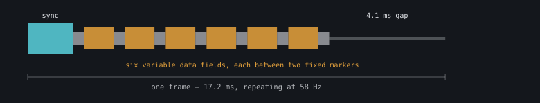

The original tapes are stereo. Left channel is the story. Right channel is the servo control track, the thing that moved the mouth and eyes in 1985. If I can read it, I get a ground-truth corpus: what the original animators thought the right answer was, on the same three motors I'm driving now.

## The corpus

Found ["Teddy Ruxpin Tapes w/ Signals"](https://archive.org/details/the-third-crystal) on the Internet Archive. World of Wonder 1986, digitised from @Reminaprod's collection, uploaded 2023-04-22 by "Decode Document Digitize" and described as "Tapes with movement data". The control track is the stated point of the upload, not a lucky side effect of someone ripping both channels.

Five stories, stereo FLAC, 81 minutes, 432 MB. The Airship, Autumn Adventure, Lost in Boggley Woods, The Third Crystal, Wooly and the Giant Snowzos.

Left and right channels are unrelated. Measured correlation 0.02.

## Physical layer: decoded

`tools/decode_control_track.py` locks onto the frame structure of all five tapes and emits per-frame data as CSV. Columns are time, frame duration, left-channel speech energy, and six data intervals. 200,785 frames total.

| Story | Lock | Period | Frames |
|---|---|---|---|
| The Airship New | 93% | 17.98 ms | 34,461 |
| Autumn Adventure New | 90% | 19.71 ms | 33,203 |
| Lost in Boggley Woods | 84% | 16.71 ms | 50,900 |
| The Third Crystal | 84% | 17.62 ms | 38,036 |
| Wooly and the Giant Snowzos | 82% | 17.85 ms | 44,585 |

**Sync and framing.** AGC-normalising against a 200 ms envelope makes one fixed threshold valid across a whole tape. The burst threshold still has to be picked per file, since tape balance between burst and body varies. Calibrate on three short windows, apply in one full pass.

**Frame period is per-tape, not universal.** 16.7, 17.6, 17.8, 17.9, and 19.7 ms across the five. Within one file, tape speed wanders 3.4%. The decoder must lock per file and normalise intervals by frame duration. Nothing may assume a fixed 17.2 ms.

**Frame layout,** from zero-crossing intervals. 76% of frames have exactly 18 zero crossings, the rest 20, 22, or 24. Always even.

| Crossings | Content |
|---|---|
| 0 to 3 | the sync burst's own crossings |
| 4, 6, 8, 10, 12, 14, 16 | fixed markers, ~0.4 ms, std ~0.02 |
| 5, 7, 9, 11, 13, 15 | six variable data intervals |
| 17, 18 | trailer, then the ~4.1 ms inter-frame gap |

Seven fixed markers bracket six data fields. Six, not the three I predicted. So it's not simply one interval per motor.

## What the data isn't

**It's discrete, not continuous.** One field resolves into three cleanly separated, evenly spaced levels: 0.62, 1.07, and 1.52 ms, steps of 0.45. Literally zero density in the gaps between them. The other fields show a sharp primary mode plus shoulders. These are symbol alphabets, not analogue positions.

**Nothing tracks speech amplitude.** Correlated against the story channel's energy, speed-normalised and detrended, no data field reaches r > 0.5 in any 10 second window of a whole file. Best is 0.41. Detrending lowers the correlation, so what little exists lives in multi-second trends, not syllable-rate tracking. A direct "interval = jaw openness proportional to loudness" reading is ruled out.

The decode is real, though. Detrended lag-1 autocorrelation of the data fields is 0.90 to 0.96. These are genuine smooth slowly-varying signals, not noise from a mis-locked detector.

So the tape wasn't deriving motion from sound. It was replaying motion somebody authored. That failure is the finding. It means the remaining work is decoding a digital payload, not rescaling an analogue one.

## Hypotheses tested and rejected

So they don't get retried:

| Hypothesis | Result |
|---|---|
| Interval = servo position proportional to loudness | No 10 s window in any file reaches r > 0.5 |
| Simple pulse count, n times a base unit | Best residual 0.16 over units 0.20 to 0.70 ms. 0.25 would be random. |
| Biphase mark / FM, as in SMPTE timecode | Only 73% of frames give a consistent bit count. A correct decode would give ~99%. |

Biphase was the best of the three and worth revisiting with a smarter cell threshold. The even zero-crossing count is still suggestive. The obstacle is that the wide intervals span 0.6 to 1.5 ms, too broad for one cell width, which hints at three symbol widths rather than two.

## Two scoring bugs that looked like answers

A caution for whoever picks this up. A lock score of "fraction of intervals inside 13 to 22 ms" is gamed by the re-trigger guard, which forces every interval above 13 ms. It reported 100% lock on a detector that was simply firing the moment the guard expired. Score tightness around the median instead.

And correlating without removing tape-speed common mode inflates everything.

## Still unknown

The payload semantics. Six discrete fields, three motors, no mapping between them. Likely either a digital word spanning several frames, or per-frame commands with channel addressing. This is real reverse engineering, not a tuning pass.

Cracking it wouldn't change how the bear speaks. It would tell me what the original animators thought the right answer was. Lead and lag between jaw and audio. Whether the jaw fully closes between words or hovers. Attack and release asymmetry. Whether the eyes follow amplitude or meaning. All of that would calibrate the live envelope with evidence instead of guesses.

And it'd make the ideal test article: play an original story through the frame protocol with its known-good animation. Anything that looks wrong is firmware, lookahead, or mechanism, never the envelope algorithm.

## References

- [Decoder in the repo](https://github.com/k0bura/SuperRux/blob/master/tools/decode_control_track.py)
- [How the mouth is driven](/projects/superrux/mouth/): what this build does instead
