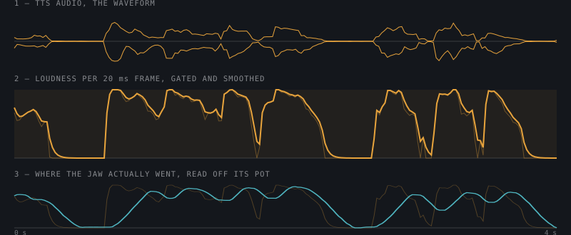
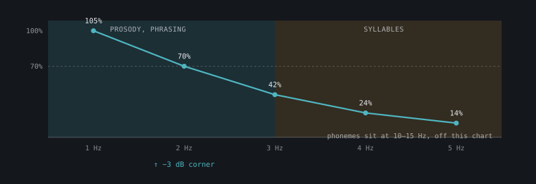
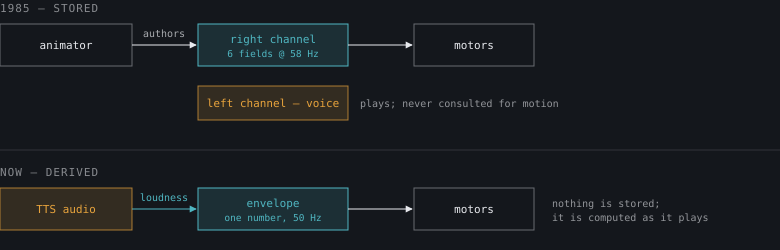

Four real seconds, measured on the bear. Bottom trace is the jaw's own potentiometer, not a simulation. It's a lagged, rounded-off copy of the loudness above it. No stage in between knows anything about words.

## There is no letter-matching step

Nothing in the pipeline detects a letter, a phoneme, or a sound. No speech recognition, no phoneme table, no viseme mapping, no text involved at any point. The jaw would behave identically if you fed it a cello. The entire input is a loudness measurement taken 50 times a second.

Four steps, no cleverness:

1. **Chop the audio into 20 ms frames.** Each gets one number, its RMS level in dB.
2. **Gate the silence.** More than 25 dB below the voice's reference counts as silence and forces the mouth shut. This closure between phrases does more visible work than any other single step.
3. **Smooth it.** One-pole, opening faster than it closes. Mouths snap open and relax shut, and that asymmetry is most of what separates speech from a hinge.
4. **Map to a jaw percentage,** scaled into the lower half of travel. Commanding the full range asks for motion the motor can't deliver and the loop saturates.

## Why that is enough

Commanded 1253 counts of travel and measured what the jaw achieved at each rate. The 3 dB point lands at 2 Hz and excursion falls as roughly 1/f above it. The mechanism is a first-order low-pass.

| Speech structure | Rate | Rendered |
|---|---|---|
| Phrasing and prosody | 1 to 3 Hz | 42 to 105% |
| Syllables | 3 to 8 Hz | 14 to 42% |
| Phonemes, individual sounds | 10 to 15 Hz | ~5% |

A perfect phoneme-accurate animation would be filtered down to about 5% of its intended motion. The gearmotor physically can't move that fast, so the effort buys almost no visible difference. Loudness isn't an approximation of the right answer here. At the rates this mechanism can render, it's most of the way to it.

The cases where loudness genuinely misleads are real but fast. An `m` is voiced and loud with the mouth shut. An `s` is quiet with the mouth open. Both are phoneme-rate events and both get smoothed into their neighbours before the jaw could have shown them.

## Two motors, not one

The mouth has two motors and the original drove them separately. A mouth whose halves move as one reads as a hinge opening, not a face speaking. So the upper jaw gets the same envelope scaled down and each half closes its own loop against its own pot.

The scaling isn't linear. At speech rates both halves are slew-limited, so a smaller command doesn't produce a proportionally smaller movement. Commanding 40% yields about 65% visually. Command roughly half the split you want to see.

| | Value |
|---|---|
| Upper slew @ duty 255 | 4.93 counts/ms |
| Lower slew @ duty 255 | 4.76 counts/ms |
| Dead time | ~65 ms |
| Total lag, command to motion | 120 to 140 ms |

That last figure is why the jaw is commanded ahead of the sound by exactly that much.

## Songs are the easy case

Counterintuitive, but singing is where this mechanism does its best work. A sustained note is 0.5 to 2 Hz of envelope content and the jaw renders essentially all of it. A speech syllable at 4 Hz gets under a quarter. Songs also skip the live pipeline, so the analysis has no latency budget to respect.

That buys the thing speech can't afford: driving the two jaw halves from genuinely separate signals. Lower follows loudness widened by the first formant, which tracks how open a vowel is. Upper follows spectral tilt, gated by loudness rather than scaled by it. Scale both by loudness and loudness dominates, the halves move as one, and it's the hinge look again.

Measured on a 28 second passage: commanded correlation between upper and lower 0.626, achieved 0.601. The halves really do move differently on the hardware. Upper travelled 864 counts against the lower's 1586. Both track their command at r = 0.96 to 0.98 at 100 ms, against speech mode's 0.878 at 140 ms. Inside its bandwidth the mechanism does what it's told.

## The eyes are driven by rhythm, not level

Amplitude-driven eyes look wrong. They read as a meter, not a face. Blinks go on phrase structure instead: in the gaps where the mouth is already shut, topped up to a natural idle rate when the speech doesn't supply enough pauses.

| Channel | Command vs achieved | Lag |
|---|---|---|
| Jaw | 0.878 | 140 ms |
| Eyes | 0.997 | 60 ms |

The eyes track almost perfectly. Not a better algorithm, the same constraint from the other side. A 340 ms blink ramp sits well inside the mechanism's bandwidth. The jaw's 0.878 is speech-rate detail the motor can't follow. Eye animation needs no cleverness to look right. The jaw will always be an approximation.

## The tape did the opposite

The original tapes are stereo and the channels are unrelated. Measured correlation 0.02. Left is the story. Right is a digital control track, framed at 58 Hz, six discrete data fields per frame.

That track is not an envelope. Nothing in it correlates with how loud the voice is. Its values are discrete, not continuous. So the tape wasn't deriving motion from sound. It was replaying motion somebody authored, stored alongside the sound and synchronised to it only because they shared a piece of tape.

| | 1985 cassette | This build |
|---|---|---|
| Source of motion | Authored by hand | Computed from loudness |
| Stored on disk | The animation itself | Nothing |
| Frame rate | 58 Hz | 50 Hz |
| Channels per frame | 6, discrete | 3, continuous |
| Position feedback | None, open loop | Pot on every shaft |
| Knows the words | The animator did | Never |
| New material | Author and press a tape | Say anything, instantly |

The trade is honest. Hand-authored animation can hold a shape through a pause and close on an `m`. It can act. What it can't do is respond to a sentence nobody wrote in advance, which is the entire point of this build.

**[Full control track analysis →](/projects/superrux/control-track/)**

---

All figures measured on the mechanism, 2026-08-27. Slew and dead time from stop-to-stop sweeps at full duty. Frequency response from sine sweeps at 1 to 5 Hz. Lag and correlation from a Fish Audio clip played through the real jaw.
